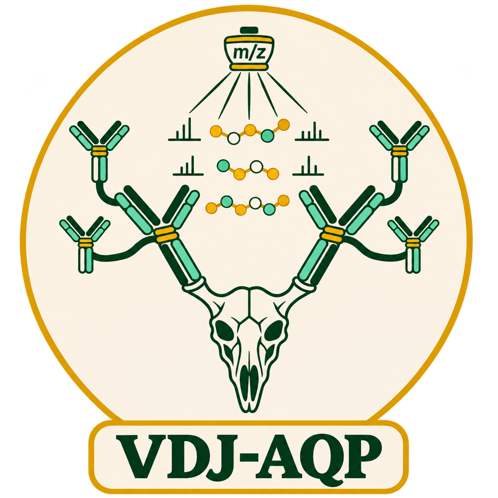

<p align="center">
<picture>
<source media="(prefers-color-scheme: dark)" srcset="assets/vdjaqp.png">

</picture>
</p>

<h1 align="center">VDJ-guided Antibody Quantification from Proteomes</h1>
<p align="center">
<a href="https://github.com/antigenomics/vdjaqp/actions/workflows/ci.yml"></a>
<a href="https://docs.isalgo.dev/vdjaqp/"></a>

<a href="LICENSE"></a>
</p>
<p align="center"><a href="https://docs.isalgo.dev/vdjaqp/quickstart.html">Quickstart</a> · <a href="https://docs.isalgo.dev/vdjaqp/">Documentation</a> · <a href="https://docs.isalgo.dev/vdjaqp/input-output.html">Output reference</a> · <a href="https://docs.isalgo.dev/vdjaqp/methods.html">Methods</a></p>

**VDJ-AQP links LC-MS/MS antibody peptides to B-cell receptor repertoire candidates.**
It keeps compatible peptide placements, credited sequence evidence and accepted
identities separate. Shared observations compete across candidates, residue
evidence is bounded, and ambiguous identities remain explicit.

The software is a Python package, runnable scripts, a Nextflow workflow and a Snakemake route for observed analysis.
[seqtree](https://github.com/antigenomics/seqtree) supplies peptide matching;
[ARDA](https://github.com/antigenomics/arda) processes both amplicon and fragmented
RNA sequencing geometries. [MIGEC](https://github.com/antigenomics/migec) provides
supported UMI molecule processing. Heavy, kappa and lambda chains retain separate
region, gene and junction readouts.

## Install

```sh
git clone https://github.com/antigenomics/vdjaqp.git
cd vdjaqp
sh setup.sh
.venv/bin/python scripts/check_environment.py
```

Python >=3.11 is required. The pinned runtime is recreated with uv from `uv.lock`;
Nextflow execution additionally requires Java 17–25 and Nextflow 25.10.2.
Optional simulation and native-tool recipes are in [`envs/`](envs/).
The Python import is `vdjaqp`; this repository is the canonical software source.

## Quick start

Run the data-free tutorial:

```sh
.venv/bin/python examples/toy/run_toy.py
```

The toy demonstrates shared and distinguishing peptide evidence using invented
sequences. Follow the [tutorial](https://docs.isalgo.dev/vdjaqp/tutorial.html) to
interpret the candidate scores.

Exercise Nextflow without scientific data (both directories must be new):

```sh
.venv/bin/python workflows/make_fixture.py tmp/example-input
nextflow run main.nf --samples tmp/example-input/samples.csv --outdir tmp/example-output --cpus 1
```

The fixture model tests software plumbing only; it is not a scientific calibration.
For an analysis, prepare candidate and peptide tables using the
[input/output contracts](https://docs.isalgo.dev/vdjaqp/input-output.html), and
copy [`workflows/samples.example.csv`](workflows/samples.example.csv):

```sh
nextflow run main.nf --samples samples.csv --outdir results/new-analysis
```

Snakemake accepts the same sample sheet. Choose a fresh output directory.

```sh
uvx --from snakemake==9.13.7 snakemake --cores 4 --config samples=samples.csv outdir=results/new-snakemake-analysis
```


Output directories must be new. Caching and resume are disabled. The workflow
retains calibration and source identities; scientific defaults are documented
in the [parameter reference](https://docs.isalgo.dev/vdjaqp/parameters.html).

## Prepare your inputs

Use MIGEC for supported UMI extraction, correction and molecule consensus, and
ARDA for repertoire annotation in both sequencing geometries. Preserve observed
sequence extent, molecule/read provenance and chain identity. CDR3 excludes the
conserved anchors; junction includes them. Do not fill missing observed sequence
from germline.

Quantify matched RNA expression independently, preserving reference versions,
counts, TPM and their normalization denominators. Transcript frequency, UMI
support and fitted peptide mixture fractions are different quantities from
protein abundance.

Preserve MS vendor raw files, acquisition metadata, converter versions and
centroiding settings. Record the protease, modifications, search database,
target/decoy strategy and calibrated confidence. Retain run/spectrum identifiers
and distinguish database-search from de novo calls. The
[preparation guide](https://docs.isalgo.dev/vdjaqp/preparation.html) covers these
upstream steps and their provenance requirements.

## Data

Companion inputs, calibration and retained results are maintained at
[isalgo/igprotseq](https://huggingface.co/datasets/isalgo/igprotseq). Access rights
and redistribution terms are separate from the software license. Downloads use
the dataset manifest and SHA-256 verification:

```sh
uv sync --frozen --extra data
.venv/bin/vdjaqp-data --help
```

See the [data reference](https://docs.isalgo.dev/vdjaqp/data.html) for groups,
authentication and pinning a dataset revision. This repository contains no
private assay inputs or stakeholder provenance.

## Reproduce an analysis

Record the software commit, the companion dataset commit and the checksums of
the candidate table, peptide table and error model. Use the publication's
stage-specific versions, parameters and input receipts for exact reproduction.
The current lockfile sets the supported runtime for this checkout. The generic
Nextflow analysis scores prepared observations; the paper's cohort preparation,
frozen decision rules and figure assembly also require their study-specific
recipes. See the [reproducibility guide](https://docs.isalgo.dev/vdjaqp/data.html).

## Documentation and development

Documentation follows Diataxis: tutorials teach a complete example; how-to guides
cover setup and preparation; reference pages define parameters and tables;
explanation pages describe the evidence model and its assumptions.

```sh
uv sync --frozen --extra test --extra docs --extra data
.venv/bin/python -m pytest tests -q
make -C docs html
```

CI checks the locked installation, synthetic tests, toy example, bootstrap CLI
and documentation with warnings as errors. Native-tool integration tests require
the optional pinned runtimes; they do not run scientific datasets in CI.

`master` is stable; `dev` integrates development. Branch features from `dev` and
submit pull requests there; promote verified changes from `dev` to `master`.
The manuscript and its host-specific analysis records remain separately maintained.
See [contributing](CONTRIBUTING.md) for checks and review, and the repository
[VDJ-AQP skill](skills/vdjaqp/SKILL.md) for agent API and workflow guidance.

## Citation and license

Cite this repository and the accompanying VDJ-AQP publication when available.

ISALGO LAB Academic and Non-Commercial Research License v1.0.
See [`LICENSE`](LICENSE). Third-party tools retain their own licenses.
